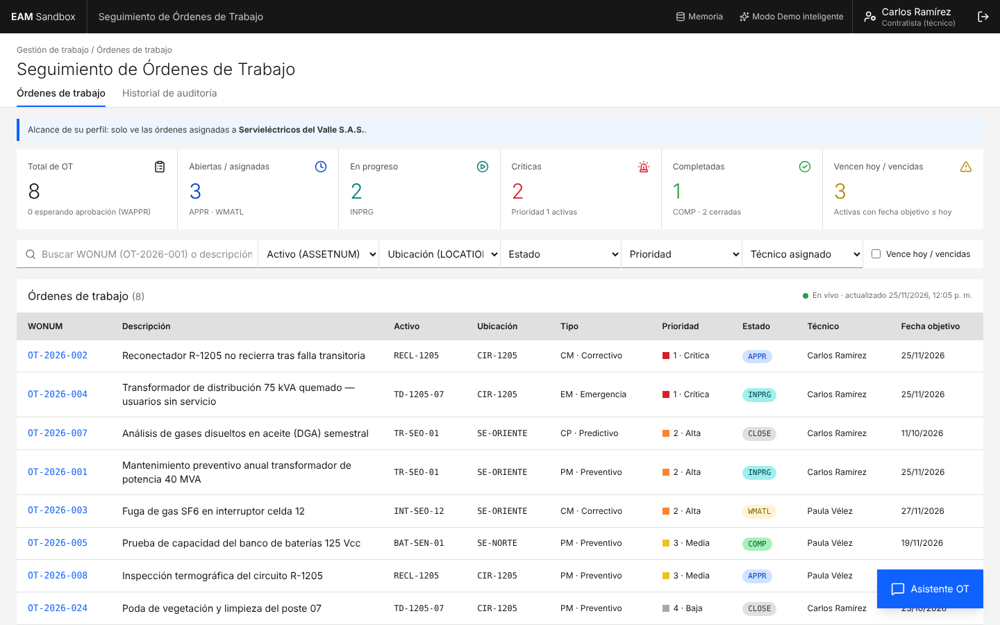
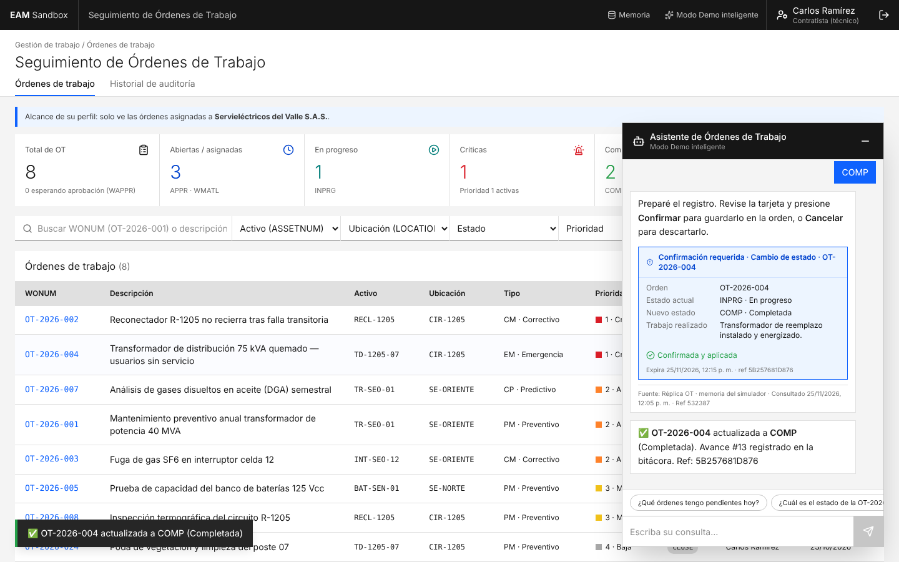
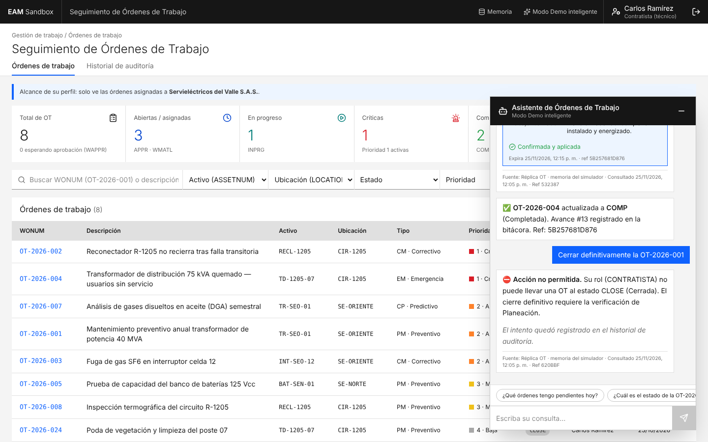
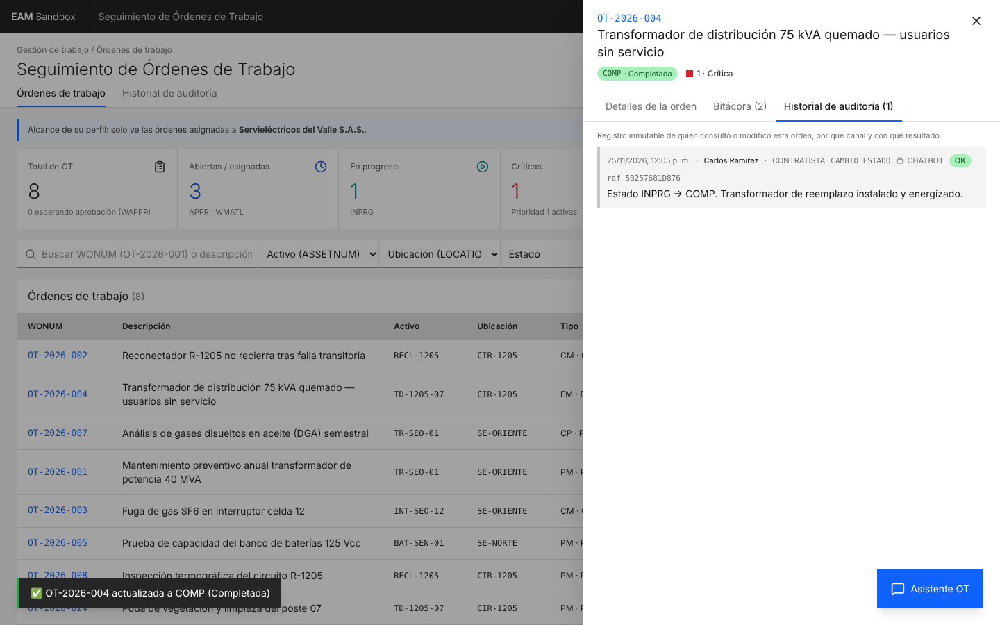
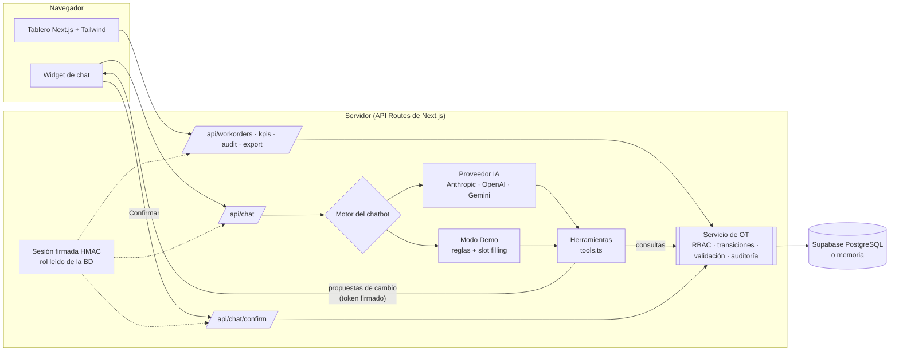
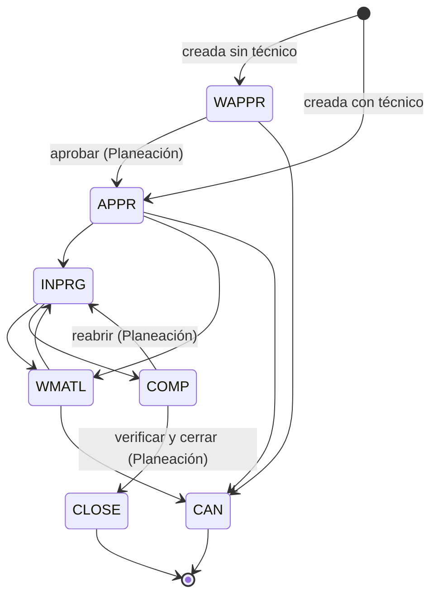

# Simulador de Seguimiento de Órdenes de Trabajo con Chatbot RBAC

Prototipo web funcional que simula la aplicación **Seguimiento de Órdenes de Trabajo** de IBM Maximo EAM para una empresa de distribución de **energía, agua y gas**, e integra un **chatbot conversacional con control de acceso por roles (RBAC)** para consultar, reportar avances y crear órdenes sin descargar ni editar reportes en Excel.

Toda modificación pasa por **confirmación explícita**, se valida contra las reglas del rol y queda en un **historial de auditoría inmutable** (quién, qué, cuándo, por qué canal y con qué resultado).

> Proyecto académico — Gerencia de Proyectos de Software, Corporación Universitaria Minuto de Dios.
> Es un *sandbox*: no se conecta al Maximo real de ninguna empresa. Los datos son ficticios.

| Tablero (perfil contratista) | Chatbot con confirmación |
|---|---|
|  |  |
| **Intento bloqueado por permisos** | **Detalle de OT · historial de auditoría** |
|  |  |

---

## 1. Qué incluye

- **Tablero estilo Maximo / IBM Carbon**: KPIs (total, abiertas/asignadas `APPR`+`WMATL`, en progreso `INPRG`, críticas P1, completadas `COMP`, vencidas), filtros por `WONUM`, activo (`ASSETNUM`), ubicación (`LOCATION`), estado, prioridad 1–4 y técnico.
- **Detalle de OT** en panel lateral con pestañas: *Detalles de la orden*, *Bitácora de trabajo (Work Log)* e *Historial de auditoría*.
- **Chatbot** (widget flotante) con tres intenciones: consulta, reporte/actualización guiada y creación de OT (solo Planeación).
- **RBAC** con tres perfiles: Contratista, Planeación y verificación, Analista de información. Cambio de perfil con PIN desde la barra superior.
- **Sincronización en vivo**: el tablero se refresca cada 5 s y de inmediato cuando el chatbot confirma un cambio.
- **Exportación CSV con código de verificación** (SHA‑256) que también queda auditada.
- **Modo Demo inteligente**: el chatbot funciona sin API Key (motor de reglas con llenado de datos paso a paso).
- **IA real opcional**: Anthropic, OpenAI o Gemini con *Function Calling / Tool Use*.
- **Modo solo lectura** (`MODO_SOLO_LECTURA=true`) para alinearse con el planteamiento teórico de un canal de consulta sin edición.

---

## 2. Arquitectura



**Principio clave:** existe **un solo punto de entrada a los datos** (`src/lib/services/workorders.ts`). La interfaz, el LLM y el modo demo pasan por él, por eso las reglas no se pueden saltar cambiando de canal. Un contratista que intente cerrar una OT es bloqueado igual por el chat, por el formulario o llamando la API directamente.

**Confirmación a prueba de manipulación:** las herramientas de escritura del chatbot (`proponer_reporte_avance`, `proponer_creacion_ot`) **no escriben**. Devuelven una tarjeta con la acción exacta firmada con HMAC (expira en 10 min y está atada al usuario). Solo `POST /api/chat/confirm` ejecuta, vuelve a validar permisos y registra la acción con su referencia; una segunda confirmación del mismo token se rechaza.

---

## 3. Estructura del repositorio

```
simulador-ot-chatbot/
├── supabase/
│   ├── schema.sql              # Tablas, restricciones, índices, RLS, auditoría inmutable
│   └── seed.sql                # Datos semilla (generado desde seed.ts)
├── scripts/
│   └── generate-seed-sql.mts   # npm run seed:sql
├── docs/img/                   # Capturas
├── src/
│   ├── app/
│   │   ├── layout.tsx · page.tsx · globals.css · icon.svg
│   │   └── api/
│   │       ├── session/        # GET sesión · POST login PIN · DELETE logout
│   │       ├── meta/           # Perfiles, activos, ubicaciones
│   │       ├── workorders/     # GET lista con filtros · POST crear
│   │       │   └── [wonum]/    # GET detalle · DELETE (siempre denegado y auditado)
│   │       │       └── progress/  # POST avance + cambio de estado
│   │       ├── kpis/ · audit/ · export/ · reset/
│   │       └── chat/           # POST conversación
│   │           └── confirm/    # POST confirmar/cancelar acción propuesta
│   ├── components/             # UI cliente (Dashboard, tabla, drawer, chat, etc.)
│   └── lib/
│       ├── types.ts            # Modelo de dominio (nomenclatura Maximo)
│       ├── domain.ts           # Catálogos, etiquetas, máquina de estados
│       ├── rbac.ts             # Permisos por rol y reglas de transición
│       ├── session.ts          # Cookie firmada HMAC
│       ├── http.ts             # Utilidades de API
│       ├── data/
│       │   ├── repository.ts   # Interfaz de persistencia + selección automática
│       │   ├── memory-repo.ts  # Implementación en memoria
│       │   ├── supabase-repo.ts# Implementación Supabase
│       │   └── seed.ts         # Datos semilla (fuente única)
│       ├── services/
│       │   └── workorders.ts   # ★ Reglas de negocio, RBAC y auditoría
│       └── chat/
│           ├── config.ts       # Selección de proveedor / modo demo
│           ├── prompt.ts       # Prompt de sistema con contexto del rol
│           ├── tools.ts        # Definición y ejecución de herramientas
│           ├── pending.ts      # Tarjetas de confirmación firmadas
│           ├── mock-engine.ts  # Modo Demo inteligente
│           ├── engine.ts       # Orquestador
│           └── providers/      # anthropic.ts · openai.ts (OpenAI y Gemini)
├── .env.example
└── package.json
```

---

## 4. Modelo de datos

| Tabla | Equivalente Maximo | Campos principales |
|---|---|---|
| `app_user` | PERSON / MAXUSER | `id`, `name`, `role`, `company`, `pin_hash` |
| `locations` | LOCATIONS | `location`, `description`, `site`, `service` |
| `asset` | ASSET | `assetnum`, `description`, `location`, `service`, `criticality` |
| `workorder` | WORKORDER | `wonum`, `description`, `assetnum`, `location`, `worktype`, `wopriority`, `status`, `status_date`, `lead`, `vendor`, `target_start`, `target_finish`, `actual_start`, `actual_finish`, `est_cost`, `actual_cost` |
| `worklog` | WORKLOG | `wonum`, `created_by`, `log_type`, `description`, `channel` (UI/CHATBOT) |
| `audit_log` | (eAudit) | `ts`, `user_id`, `role`, `action`, `wonum`, `channel`, `result` (OK/DENEGADO/ERROR), `detail`, `ref`, `before_data`, `after_data` |

**Estados y transiciones permitidas**



`CLOSE` y `CAN` son estados históricos: el registro queda bloqueado.

---

## 5. Matriz de permisos (RBAC)

| Acción | Contratista | Planeación y verificación | Analista |
|---|:-:|:-:|:-:|
| Ver OT | Solo de su empresa | Todas | Todas |
| Registrar avance en bitácora | ✅ | ✅ | ❌ |
| Pasar a `INPRG`, `WMATL`, `COMP` | ✅ | ✅ | ❌ |
| Aprobar (`APPR`), cerrar (`CLOSE`), cancelar (`CAN`) | ❌ | ✅ | ❌ |
| Crear OT | ❌ | ✅ | ❌ |
| Eliminar OT | ❌ | ❌ | ❌ |
| Ver auditoría | Solo sus eventos | Toda | Toda |
| Exportar CSV verificable | ❌ | ✅ | ✅ |
| Restablecer datos demo | ❌ | ✅ | ✅ |

Todo intento denegado se registra en `audit_log` con resultado `DENEGADO`.

**Perfiles de prueba**

| Perfil | Usuario | PIN |
|---|---|---|
| Contratista · Servieléctricos (energía) | `tec.cramirez` Carlos Ramírez | 1111 |
| Contratista · Servieléctricos (energía) | `tec.pvelez` Paula Vélez | 1212 |
| Contratista · Hidroservicios (agua) | `tec.lherrera` Luisa Herrera | 2222 |
| Contratista · Gasred (gas) | `tec.jmoreno` Julián Moreno | 5555 |
| Planeación y verificación | `plan.arestrepo` Ana María Restrepo | 3333 |
| Analista de información | `anal.jgomez` Jorge Gómez | 4444 |

---

## 6. Ejecutar en local

Requisitos: Node.js 20.9 o superior.

```bash
npm install
cp .env.example .env.local      # en Windows: copy .env.example .env.local
npm run dev                     # http://localhost:3000
```

Sin configurar nada más, la app usa **memoria del servidor** y el **Modo Demo** del chatbot.

---

## 7. Subir a GitHub

```bash
git init
git add .
git commit -m "feat: simulador de OT con chatbot RBAC y auditoría"
git branch -M main
git remote add origin https://github.com/<su-usuario>/simulador-ot-chatbot.git
git push -u origin main

# Rama de desarrollo
git checkout -b develop
git push -u origin develop
```

Estrategia de ramas sugerida:

| Rama | Uso |
|---|---|
| `main` | Versión estable; Vercel la publica como producción |
| `develop` | Integración de cambios; Vercel genera una URL de vista previa |
| `feature/<tema>` | Un cambio por rama (ej. `feature/campos-liquidacion`), se fusiona a `develop` con Pull Request |

El archivo `.gitignore` ya excluye `.env.local`: **nunca suba llaves** al repositorio.

---

## 8. Base de datos en Supabase (persistencia compartida)

1. Cree un proyecto gratuito en [supabase.com](https://supabase.com).
2. Abra **SQL Editor → New query**, pegue el contenido de `supabase/schema.sql` y ejecútelo.
3. Cargue los datos: ejecute `supabase/seed.sql` **o** entre a la app con Planeación/Analista y pulse **Restablecer datos** (recomendado: calcula las fechas con la zona horaria de Colombia).
4. En **Project Settings → API** copie la *Project URL* y la *service_role key*.

> La `service_role key` solo se usa en el servidor (API Routes). El navegador nunca accede a la base de datos: RLS está activo sin políticas públicas.

---

## 9. Despliegue gratuito en Vercel

1. Entre a [vercel.com](https://vercel.com) con su cuenta de GitHub → **Add New… → Project** → importe el repositorio.
2. Framework: **Next.js** (se detecta solo). No cambie los comandos de build.
3. En **Environment Variables** agregue:

| Variable | Valor | Obligatoria |
|---|---|---|
| `SESSION_SECRET` | Cadena aleatoria de 32+ caracteres | Sí |
| `SUPABASE_URL` | URL del proyecto Supabase | Recomendada |
| `SUPABASE_SERVICE_ROLE_KEY` | service_role key | Recomendada |
| `LLM_PROVIDER` | `mock`, `anthropic`, `openai` o `gemini` | No (por defecto `mock`) |
| `LLM_API_KEY` | API Key del proveedor | Solo si usa IA |
| `LLM_MODEL` | Modelo específico | No |
| `MODO_SOLO_LECTURA` | `true` / `false` | No |
| `APP_TIMEZONE` | `America/Bogota` | No |
| `OCULTAR_PINS_DEMO` | `true` para no mostrar los PIN | No |

4. **Deploy**. Vercel entrega una URL pública (`https://simulador-ot-chatbot.vercel.app`) para compartir con evaluadores.

Generar `SESSION_SECRET`:

```bash
node -e "console.log(require('crypto').randomBytes(32).toString('hex'))"
```

> Sin Supabase, cada instancia de Vercel tiene su propia memoria y los datos se reinician; sirve para una demostración rápida, pero para que todos vean los mismos cambios configure Supabase.

---

## 10. Guion de demostración (5 minutos)

1. **Contratista** (Carlos, 1111) → chat: «¿Qué órdenes tengo pendientes hoy?». Solo aparecen OT de su empresa.
2. «Quiero reportar avance en la OT-2026-002» → describa el trabajo → elija `INPRG` → **Confirmar**. La tabla y la bitácora se actualizan solas.
3. «Cerrar definitivamente la OT-2026-001» → bloqueado. «Estado de la OT-2026-010» → fuera de alcance (es de otra empresa).
4. **Planeación** (Ana, 3333) → «Crear una nueva orden de trabajo» → el bot pide activo, ubicación, falla, prioridad, tipo y técnico → **Confirmar**.
5. «Cerrar la OT-2026-005» → verificación y cierre. «Eliminar la OT-2026-009» → denegado para todos.
6. **Analista** (Jorge, 4444) → pestaña **Historial de auditoría → Solo denegados**: aparecen todos los intentos anteriores con usuario, canal y referencia. **Exportar CSV** muestra el código de verificación.

---

## 11. Seguridad y límites del prototipo

- Sesión en cookie `httpOnly` firmada con HMAC; el rol se lee de la BD en cada petición (el cliente no puede declararse otro rol).
- Validación de entradas en servidor, máquina de estados y alcance por empresa.
- Auditoría *append-only* (en Supabase un *trigger* impide `UPDATE`/`DELETE`).
- El prompt del LLM ignora instrucciones de cambio de rol; de todos modos los permisos no dependen del modelo, sino del servicio.
- Es un simulador: el acceso con PIN reemplaza el inicio de sesión corporativo (SSO/LDAP) que tendría producción, y el sondeo cada 5 s reemplaza un canal en tiempo real (Supabase Realtime).

---

## 12. Mejora continua: conectar el documento teórico del proyecto

Cuando el documento final defina nombres de campos o reglas de negocio específicas, cada cambio tiene un único lugar:

| Si el documento cambia… | Edite | Nota |
|---|---|---|
| Nombres/campos de la OT (ej. agregar presupuesto aprobado vs. ejecutado, acta de liquidación, materiales, servicios) | `src/lib/types.ts` → `supabase/schema.sql` → `src/lib/data/seed.ts` | Luego `npm run seed:sql` y muestre el campo en `WorkOrderDrawer.tsx` |
| Estados o transiciones | `src/lib/domain.ts` (`STATUS_LABEL`, `TRANSITIONS`) | El `check` de `status` en `schema.sql` debe coincidir |
| Roles y permisos | `src/lib/rbac.ts` (`ROLE_PERMISSIONS`, `ROLE_STATUS_TARGETS`) | Agregue el rol también en el `check` de `app_user.role` |
| Reglas de validación (campos obligatorios, longitudes, quién crea) | `src/lib/services/workorders.ts` (`validateCreate`, `precheckProgress`) | Aplica a UI, chatbot y API a la vez |
| Lo que el bot puede responder o preguntar | `src/lib/chat/tools.ts` (nuevas herramientas) y `src/lib/chat/prompt.ts` | En modo demo, agregue la intención en `mock-engine.ts` |
| Canal de solo lectura (objetivo general del documento) | Variable `MODO_SOLO_LECTURA=true` | Bloquea toda escritura y deja la auditoría de cada consulta |

Flujo recomendado: cree una rama `feature/<cambio>`, guarde en `docs/` la versión del documento que origina el cambio (diccionario de datos o reglas), haga el ajuste y abra un Pull Request hacia `develop`. Así cada regla del software queda trazable a la sección del documento que la justifica.

---

## Scripts

| Comando | Descripción |
|---|---|
| `npm run dev` | Desarrollo en `localhost:3000` |
| `npm run build` / `npm start` | Compilación y ejecución de producción |
| `npm run typecheck` | Verificación de tipos TypeScript |
| `npm run seed:sql` | Regenera `supabase/seed.sql` desde `src/lib/data/seed.ts` |
